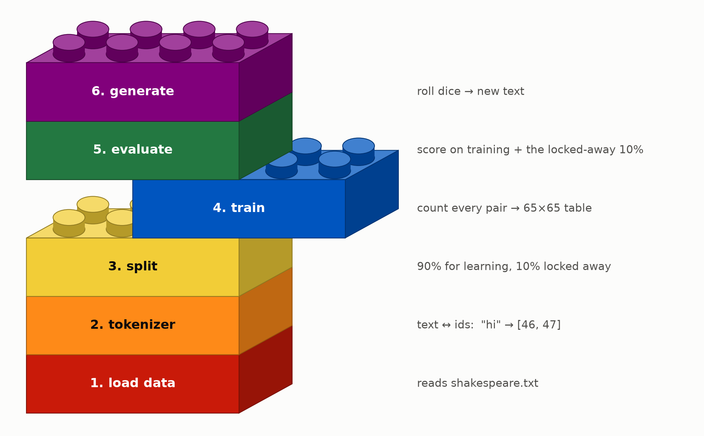

# Just Count: The Smallest Model That Writes

*Hello everyone! I recently started exploring how LLMs work, to get a better understanding of a technology that has crept into almost every part of our lives in the last few years. I'm starting this series to document what I learn and share it with the world.*

---

## The plan for this series

This is Part 1 of a series where I build a **language model from scratch, one idea at a time**, as someone who isn't comfortable with neural networks yet. I'm following Andrej Karpathy's ["Let's build GPT"](https://www.youtube.com/watch?v=kCc8FmEb1nY), split into small levels I can actually understand:

1. **This post:** the smallest *complete* system: load some text, build a simple model that learns from it and writes, and find a way to **score** it. Our model is deliberately dumb. What matters is the setup.
2. **The posts after this:** one new idea per post, each one adding a row to a **scoreboard** that goes from random gibberish to something that actually reads like text. I'm starting with Shakespeare, like Andrej, so my numbers can be checked against his. The end goal is a model that learns from and writes **Indian text**. (Which datasets should I try? Tell me in the comments :P)

---

## What is an LLM?

LLM stands for **Large Language Model**. It's a program that **predicts the next word** (more precisely, the next *token*) in a language it was trained on.

That's really the whole trick. Predict the next token, add it to the text, and ask again. Do that in a loop and the model *writes*:


*Made-up probabilities, but the loop is real: guess the next word, pick one, append it, repeat.*

Let's break down each word in LLM:

**Large:** everything about these models is huge.

- **Data:** trillions of words: a big chunk of the public internet, books and code. A person reading 8 hours a day would need hundreds of thousands of years to get through it.
- **Compute:** training one takes thousands of GPUs running for weeks or months.
- **Parameters:** the adjustable numbers inside the model, tuned during training. GPT-3 (2020) had **175 billion** of them, and today's models have hundreds of billions or more.

**Language:** almost all of that data is human language (articles, books, conversations), plus code, which is a language too. Language is what the model learns, and language is what it produces.

**Model:** the machine itself: a giant formula full of those parameters (also called *weights*). It doesn't look anything up. Everything it learned is squeezed into those numbers, and from them it computes a probability for every possible next token.

If you want a beautiful visual introduction to all this, I highly recommend 3Blue1Brown's [Large Language Models explained briefly](https://www.youtube.com/watch?v=LPZh9BOjkQs).

Now for the fun part. Strip away the **Large**, and what's left, a **language model**, is something we can build on a laptop. The one in this post has **4,225** parameters. GPT-3 has 175 billion. Same idea, just a little smaller. :)

---

## How to build a machine that writes *something*?

Hmm, the simplest way: ask the machine to pick random characters, one after another, and boom, you have a machine that writes, hehe :P

```python
# an extremely dumb machine that writes, hehe..
chars = sorted(set(text))  # every distinct character in our text (65 for Shakespeare)
for i in range(200):
    print(random.choice(chars), end="")
```

I actually ran it. It writes:

```
B$WSPEA;p&$;OQz$MoPsW
HpeWGOeA;j?gfU'tCj:YhL.'QY:Q?jWthHigNV3ISHujVPc-Q&bmV.ObOyltFUESUpmhPEy;,BGHp.kjuT BVeBYqHt
UzJzAZzMGiH
cx!BhaR-R::x.DDvIUpOMamirsCSP.e!QP
```

Technically, that's writing. But it's a very dumb idea, because no human can read it. Every character is equally likely, so `$` and `z` show up just as often as `e` and space.

What could be a better idea?

**The insight:** instead of picking each character at random, pick it based on **how likely it is to come next**. In English, `e` is far more common than `z`, and after `q` comes `u` almost every time. Even a rough guess like that beats picking at random.

But how do we calculate those probabilities? How do we know what comes after `_`?

Answer: We learn them from examples. For that we first need a **dataset**: a long piece of real text where we can see which characters tend to follow which. I'm using [Tiny Shakespeare](https://raw.githubusercontent.com/karpathy/char-rnn/master/data/tinyshakespeare/input.txt), which contains about 1.1 million characters of plays:

```
First Citizen:
Before we proceed any further, hear me speak.
--
cat datasets/shakespeare.txt | wc
40000  202651 1115394
```

Once we have the probabilities, writing is the same loop as the LLM animation above, just one character at a time:


*Real probabilities this time, from the model we build in this post. It only looks at the last character, which is why "hear me sp" turns into "hear me spear" instead of "speak". The picks are dice rolls, so it doesn't always take the tallest bar.*

That's also what ChatGPT does, just with tokens instead of characters and a much better predictor.

---

## Okay, so how do we turn it into code? What do we build?

If you've followed along so far, the next steps are fairly obvious. To build this machine we need to:

1. **Load** the text.
2. **Turn it into numbers**, because computers only understand numbers.
3. **Hide a slice** of it, so we can later test the model on text it has never seen.
4. **Count** every pair of neighbouring characters and store the probabilities in a table. That table is our model, and the counting is our "training".
5. **Evaluate** how good the model is.
6. **Generate** new text by rolling dice with those probabilities. Yay!



*Our Lego pieces, stacked from the bottom up: each step builds on the one below.* 

---

## What's the simplest idea that could possibly work?

Our random writer from earlier picks every character with the same 1-in-65 chance. That's why it writes `B$WSPEA;p&$…`. It knows nothing about the text.

So how would *you* guess the next character, if all you had was Shakespeare and a pencil?

**Attempt 1: guess the most common character.**  
Count every character in the text. Space shows up 15% of the time and `e` 8.5%, while `z` and `X` almost never do. What if our machine rolls dice weighted by these counts? Let's try it:

```python
# slightly less dumb: common characters get picked more often
char_counts = Counter(text)
chars, counts = list(char_counts.keys()), list(char_counts.values())
print("".join(random.choices(chars, weights=counts, k=200)))
```

It writes:

```
pfeotmehL D dWsmeraee,hamonbh a'n  rfporedpac  n'h hwnhohod. Tffhr
unv,
uyeoo rsrtm ;mloewlIeutcereawy :potake hcetna iwd gohl  nedtmh ,ra k foetA
```

Still gibberish, but it *looks* more like text. Compare it with the random writer:

| | Random writer | Weighted by counts |
| --- | --- | --- |
| Spaces | 0.6% | 12% |
| `e` | 2.5% | 8.5% |
| Rare stuff (`z`, `X`, `$`, `&`) | 5.6% | 0% |

**Attempt 2: look at what came just before.**  
One key observation: context matters a lot in guessing what comes next. Try it yourself, what's the blank in "afte_"? 

You didn't need a dice roll for that, right?

But how do we embed this observation into our model?

Answer: rather than guessing over the entire text, what if we only guess what's likely to come after the *current* character? (i.e. what if we start with just one character of context?)

For example, in our Shakespeare text, `q` is followed by `u`... all 609 times. After `t`, `h` is the top pick (hello, "the"). The character you're on tells you a lot about the next one.

So instead of one big tally, we keep **one tally per character**: "what usually comes after `a`?", "what usually comes after `b`?", and so on.

**Why stop at one character?**  
Fair question. Two characters of memory would be smarter (`th` → `e` is a strong bet). But the table grows fast:

| Look back | Table size |
| --- | --- |
| 1 character | 65 × 65 = **4,225** |
| 2 characters | 65 × 65 × 65 = 274,625 |
| 3 characters | 65⁴ = 17,850,625 |

And most of those rows would be empty, because the text simply doesn't contain most combinations. So let's start with the smallest one.

So here's our model: **look only at the current character, and guess the next one based on what usually followed it.** It's called a **bigram** model ("bi" = two: the current character and the next).

Let's dry run this. A tiny alphabet `{h, e, l, o}` and the training text `hello`. Every pair of neighbours is one example:

```
h→e   e→l   l→l   l→o
```

Tally them into a table. Each row is the current letter, each column is what came next:

```
              next letter
             h   e   l   o
current  h [ 0   1   0   0 ]
         e [ 0   0   1   0 ]
         l [ 0   0   1   1 ]   ← after 'l': 'l' once, 'o' once
         o [ 0   0   0   0 ]
```

Divide each row by its total and we get... **probabilities**! Row `l` becomes 50% `l`, 50% `o`. That's all this formula says:

```
P(next | current) = count(current, next) / count(current)
```

Now to **generate**, look up the current letter's row and roll a die weighted by it:

```
start 'h' → always 'e' → always 'l' → 50% 'l' / 50% 'o' 🎲
```

That's it! For Shakespeare it's a 65×65 table, filled in with one pass over the text. No training loop, no gradients. **Just count.**

```python
# line the text up against itself shifted by one: "First" -> (F,i) (i,r) (r,s) (s,t)
current, following = data[:-1].tolist(), data[1:].tolist()
pair_counts = Counter(zip(current, following))
```

Here's the real table, zoomed in on space and lowercase letters:


*Each row is one die. Darker = more likely next character. (Rows don't add to 100% here because uppercase and punctuation are cropped out.)*

Even this dumb table picked up some real English:

| After… | Top guess for next | How often | Why |
| --- | --- | --- | --- |
| `q` | `u` | 90% | English almost always writes "qu" |
| `t` | `h` | 34% | Hello, "the" |
| `y` | space | 50% | Lots of words end in y |
| `d` | space | 45% | Lots of words end in d |

### What about pairs we never saw?

There's one more problem to solve first. Look at the heatmap again: lots of white squares. Those are pairs that never showed up in the training text, so the model gives them **0%**. i.e. not "unlikely" but *impossible*.

| Pairs | Count |
| --- | --- |
| Possible pairs (65 × 65) | 4,225 |
| Seen in the training text | 1,380 |
| Never seen, so the model gives them **0%** | 2,845 |
| Pairs in the locked-away 10% that never appeared in training | **187** |

And those 187 aren't weird typos. They're real words:

| Pair | Where it shows up in the locked-away text |
| --- | --- |
| `dt` | "what a spen**dt**hrift is he" |
| `fn` | "would cure dea**fn**ess" |
| `z!` | "should--buz**z!**" |

And our model is 100% sure nobody could ever write "spendthrift"!

The fix is **smoothing**: pretend every pair was seen **once** extra before counting. This ensures even unseen pairs get a tiny chance instead of zero:

```python
probs = (counts + 1) / (counts + 1).sum(dim=1, keepdim=True)   # +1 = smoothing
```

| | Without smoothing | With smoothing |
| --- | --- | --- |
| Generated text | `Cars an tcede.` `Y in, lanoul-see waindonse…` | `Cprs an tcede.` `YEin, lanoul-see waindonse…` |
| Never-seen pairs in 2,000 generated characters | 0 | 4 (`Cp`, `YE`, `wx`, `OI`) |
| Chance of `d` → `t` | **0%** (impossible) | 0.0035% (rare, but possible) |

The writing barely changes, but nothing is impossible anymore. By the way, this +1 trick isn't special to language models. It shows up anywhere we estimate chances by counting, 3Blue1Brown's [video](https://www.youtube.com/watch?v=8idr1WZ1A7Q) explains it beautifully.

---

## How do we know if it's any good?

Our model hands out a probability for every possible next character. So how do we grade it?

The obvious idea is to check how often the model's top guess is right. But is that a good measure for language? Think about it for a sec.

After `"th"`, both `e` ("the") and `a` ("that") are fine. A model that says *"e 60%, a 30%"* is doing a good job, but accuracy marks it **wrong** every time the real answer is `a`. Accuracy only counts the top guess and throws away everything else the model said.

So what else could we measure? Think about what happens in *your* head when you read. After `q` you see `u`, and... nothing happens, you saw it coming. After `q` you see `z`, and you go "huh?". You were **surprised**.

That's a better way to grade the model: show it real text and check how surprised it was. If it predicted the next character well, it wasn't surprised. If its prediction was off, it was surprised, and that means it did poorly on that bit of text.

But how do we calculate surprise? Is that even something we can put a number on? Let's build it one step at a time.

### Step 1: score a single guess

Take one real pair from the text, say `t` followed by `h`. Ask the model: **how much probability did you give to what actually came next?**

```python
p = probs[current][following]   # the chance the model gave to the real next character
```

Our counted table says that after `t`, the chance of `h` is **34%**. That's a decent guess. If it had said 90%, even better. If it had said 1%, it was badly caught off guard.

In other words, So the higher the '`p` '(probability), the less surprised the model was. hmm,

### Step 2: turn probability into surprise

Before looking at any formula, try filling this in yourself. How surprised *should* the model be?

| The model gave the real next character… | Surprise should be… |
| --------------------------------------- | ------------------- |
| 100%                                    | ?                   |
| 50%                                     | ?                   |
| 1%                                      | ?                   |
| 0%                                      | ?                   |

Got a feel for it? At 100% the model was sure and right, so there's no surprise at all: zero. The smaller the chance, the bigger the surprise. And at 0%, the model said "this can't happen", and then it happened. You can't get more surprised than that.

Turns out there's a formula that does exactly this. It's not a new idea, by the way: Claude Shannon worked it out in 1948, when he founded information theory.

```python
surprise = -math.log(p)   # natural log
```

| The model gave the real next character… | How surprised? | Surprise |
| --------------------------------------- | -------------- | -------- |
| 100%                                    | not at all     | **0**    |
| 50%                                     | a bit          | **0.69** |
| 1%                                      | very           | **4.6**  |
| 0%                                      | infinitely     | **∞**    |

Does it match your table? It ticks every box:

- **Sure and right costs nothing.** 100% → 0.
- **The less you expected it, the more it hurts.** And it hurts *a lot* near 0%. Saying "this will never happen" and then being wrong is the worst possible mistake. Remember the +1 smoothing? This is why it matters: no pair is ever given exactly 0%, so the surprise never hits ∞.

> **🐇 Rabbit hole: why** `-log`**, of all things?**
>
> Flip a coin and get heads: that's a 50% event, surprise `-log(0.5)` = 0.69. Flip again, heads again. How surprised should you be by *two* heads in a row?
>
> It feels like it should be one surprise plus another: 0.69 + 0.69 = 1.39. Now check: two heads is a 25% event, and `-log(0.25)` = **1.39**. The surprises just add up!
>
> That's the whole reason for the log: probabilities *multiply* (50% × 50% = 25%), but surprise should *add*, and log is the function that turns multiplying into adding. Shannon's insight, in one coin flip.
>
> Go deeper: [Information is surprise](https://plus.maths.org/information-surprise) on Plus Magazine is a gentle read. StatQuest's [Entropy (for data science) Clearly Explained!!!](https://www.youtube.com/watch?v=YtebGVx-Fxw) builds surprise from scratch, and 3Blue1Brown's [Solving Wordle using information theory](https://www.youtube.com/watch?v=v68zYyaEmEA) shows the same idea through a game.

### Step 3: average it over lots of text

One guess tells us little. So walk through real text and score **every** character, then take the average. Here's our model reading `" the king"`:

| Current → next | Chance the model gave | Surprise |
| -------------- | --------------------- | -------- |
| `␣` → `t`      | 14.1%                 | 1.96     |
| `t` → `h`      | 34.1%                 | 1.08     |
| `h` → `e`      | 35.3%                 | 1.04     |
| `e` → `␣`      | 29.2%                 | 1.23     |
| `␣` → `k`      | **0.9%**              | **4.66** |
| `k` → `i`      | 14.4%                 | 1.94     |
| `i` → `n`      | 23.2%                 | 1.46     |
| `n` → `g`      | 10.7%                 | 2.24     |
|                | **average**           | **1.95** |

"the" is easy for it. Then a word starting with `k` comes along, which it didn't see coming at all, and the surprise spikes.

In code, that's the whole idea:

```python
def average_surprise(probs, data):
    surprises = []
    for current, following in zip(data[:-1], data[1:]):   # every neighbouring pair
        p = probs[current][following]
        surprises.append(-math.log(p))
    return sum(surprises) / len(surprises)
```

**That average is the loss.** Its official name is **cross-entropy** (Aurélien Géron's [11-minute intro](https://www.youtube.com/watch?v=ErfnhcEV1O8) is the clearest explanation I found). Lower loss = less surprised by real text = a better model.

#### The same thing in our real code

The loop above is for understanding. In `mini_gpt`, the scoring happens in one line of `models/base.py`:

```python
logits = self.logits(idx)                    # for each current character: a row of 65 scores
loss = F.cross_entropy(logits, targets)      # average surprise at the real next characters
```

`F.cross_entropy` is PyTorch's built-in version of our `average_surprise`. Spelled out, it does exactly the three steps from above:

```python
probs = F.softmax(logits, dim=-1)            # scores -> probabilities (each row adds up to 100%)
p = probs[range(len(targets)), targets]      # Step 1: the chance each real next character got
loss = (-p.log()).mean()                     # Steps 2 and 3: surprise, then average
```

### Step 4: what's a good number?

A loss number means nothing alone. We need some reference points to compare it:

- **Perfect:** loss 0. Never achievable, because language is genuinely uncertain. Even Shakespeare couldn't tell you for sure what comes after "th".
- **Random guessing:** every one of the 65 characters equally likely, so every guess gets 1/65:
  ```python
  -math.log(1 / 65)   # = 4.17
  ```

  **This is the bar every model must clear.** Anything near 4.17 has learned nothing.

[this is food for thought section idea -> we need a short sections like this to encourage users to think more deeply or in a alternative fasion or to challenge their understanding with wisdom nuggets, we can expand this a bit more with some visualization if needed, here the insight is, the lower the characters or tokens the model is torn between, the better the outcome.]  

> **🐇 Rabbit hole: what does a loss number actually *feel* like?**
>
> Loss numbers are hard to feel. Here's a trick: `e^loss` tells you roughly how many characters the model is "torn between".
>
> Try it: random guessing is `e^4.17` = **65**, torn between everything. A loss of 2.46 is `e^2.46` ≈ **12**. Same alphabet, but now it's like choosing among 12 instead of 65. What would a loss of 0.69 mean? (`e^0.69` = 2: a coin flip between two characters.)
>
> So every drop in loss shrinks the model's "shortlist". Keep an eye on this number as the series goes on.

### Step 5: training vs validation, the honesty check

There's one trap left. If we score the model on the **same** text it learned from, it can look great just by having memorized that text. A student who has seen the exam answers will ace the exam, but that doesn't mean they learned anything.

That's why, before any counting, we locked away the last 10% of the text:

```python
n = int(0.9 * len(data))
train_data = data[:n]   # the model learns from this
val_data   = data[n:]   # the model never sees this until the test
```

Only `train_data` ever changes the model. Then we score it on **both** parts, using exactly the same measuring stick:

```python
model.count_pairs(train_data)   # learn: only from the training text
probs = model.log_probs.exp()   # the counted table, as probabilities

training_loss   = average_surprise(probs, train_data)   # how well it fits what it studied
validation_loss = average_surprise(probs, val_data)     # how well it does on new text
```

How to read the two numbers:

- **Both close together:** the model learned patterns that carry over to new text. 👍
- **Training loss much lower than validation loss:** the model memorized its training text instead of learning general patterns. That's called **overfitting** (StatQuest: [Bias and Variance](https://www.youtube.com/watch?v=EuBBz3bI-aA)).

Validation loss is the honest number, so **validation loss is the number that goes on the scoreboard.**

### Step 6: a poll, not a census

To get the exact loss, we'd score **every** character: about 1 million in the training text and 111,540 in the validation text. Do we really need all of them?

Think of an election poll. Nobody asks the whole country. You ask a few thousand random people and get very close to the real answer.

Our code does the same. `get_batch` grabs 32 random chunks of 8 characters, and we average 50 of those batches, which is **12,800 guesses** in total:

```python
def estimate_loss(model, data, cfg):
    losses = []
    for _ in range(cfg.eval_iters):                              # 50 batches
        x, y = get_batch(data, cfg.batch_size, cfg.block_size)   # 32 random chunks of 8
        loss = model.loss(x, y)                                  # average surprise on this batch
        losses.append(loss.item())
    return sum(losses) / len(losses)
```

For our tiny table, scoring everything would be instant. But real LLMs train on *hundreds of billions* of tokens, and scoring all of them for every progress report would cost about as much as the training itself.

What's the catch? A poll is a little noisy. Here's what I got running the same poll 20 times:


Every poll lands between 2.45 and 2.49, around the exact value of 2.482. So **a difference in the second decimal place is just noise**. 

---

## So... did it work?

### Before: an empty table

Before counting, the table is all zeros (plus smoothing), so every character is equally likely. Quick quiz before you look: what loss should it get? (Hint: Step 4.)

```
training_loss 4.1744  validation_loss 4.1744
```

Exactly the random-guessing anchor, -log(1/65) = 4.17. An empty table *is* random guessing:

```
CpzlYaS ;czde.'wEiT,YVrzlGu-?YeNY
ijbo
Lzzj$KUKS-A.U FisVJiG HT,OP;W;,qe$zOAnsz-imHzPAkfEfYSgS;RTNBE:myOzk.
```

### After: one counting pass

```
final: training_loss 2.4702  validation_loss 2.4599
```

```
Hanthniler pr e bla? br s rer?
onto y wha the ow, out r iloreatt s, te britemingoree ge.'setharme thex?
Cas we kide frd.
RIZAthigik!
thay taty we boors flce IO:
```

It's still gibberish, but it's **shaped** gibberish: word-sized chunks, spaces in sensible places, capitalized lines, `the`, `we`, `out`, even a speaker-ish `RIZA` and `IO:`. All from a table of pair counts.

### Reading the numbers

Now we can read these numbers with everything from the previous section:

|                 | training_loss | validation_loss | Torn between about… |
| --------------- | ------------- | --------------- | ------------------- |
| before counting | 4.17          | 4.17            | 65 characters       |
| after counting  | 2.47          | 2.46            | 12 characters       |

- **4.17 → 2.46:** the model went from torn between all 65 characters to torn between about 12. That's a lot of uncertainty removed just by counting.
- **Training ≈ validation, so no overfitting.** Why not? Think about it: the model has only 65×65 = 4,225 numbers, and it read a million characters. There's simply no room to memorize the text. All it *can* store is general patterns.
- **Wait, validation is *lower* than training?** Shouldn't it be the other way around? It is, actually. Scored on every character, training is 2.455 and validation is 2.482. The flip is just the poll noise from Step 6.

---

## Scoreboard v1

| Level | Model        | How it learns | Validation loss | Sample                    |
| ----- | ------------ | ------------- | --------------- | ------------------------- |
| —     | random guess | —             | 4.17            | `CpzlYaS ;czde.'wEiT`     |
| 0     | BigramCounts | counting      | **2.46**        | `thay taty we boors flce` |


From 4.17 to 2.46 just by counting pairs!

---

## How can we do better than this?

This model has a hard limit: it **only ever sees one character**. After `e`, it can't tell whether it's in `"the "` or `"thee"` or `"here"`. To look further back we'd need a bigger table: two characters back is 65³ ≈ 275k cells, and eight back is 65⁹ ≈ 21 quadrillion cells. Most of which would be empty. **Counting doesn't scale.**

So the next step is to stop counting and start **learning** the table instead, by trial and error, with a method that doesn't care how big the model gets. That method (gradient descent) is what eventually trains a GPT. 

---

## Wrapping up

In this post we built:

- **A pipeline:** load data → tokenizer → training / validation split → train → evaluate → generate.
- **The simplest language model:** a 65×65 table of "what usually comes next", trained by just counting.
- **A way to score it:** the average surprise (cross-entropy), measured on text the model has never seen, with two anchors (4.17 = random, 0 = perfect) and a poll to keep it fast.
- **Scoreboard v1:** from 4.17 to 2.46.

**Next post:** *Same score, new engine.* We throw away counting, start from a table of zeros, and teach it by nudging, and we'll watch the loss fall step by step.

If something here didn't click, or you know a better way to explain it, tell me in the comments. I'm learning this too :)

---

*Code for this post:* [mini_gpt/](../mini_gpt/) · *run it with* `uv run python mini_gpt/train.py --model BigramCounts`