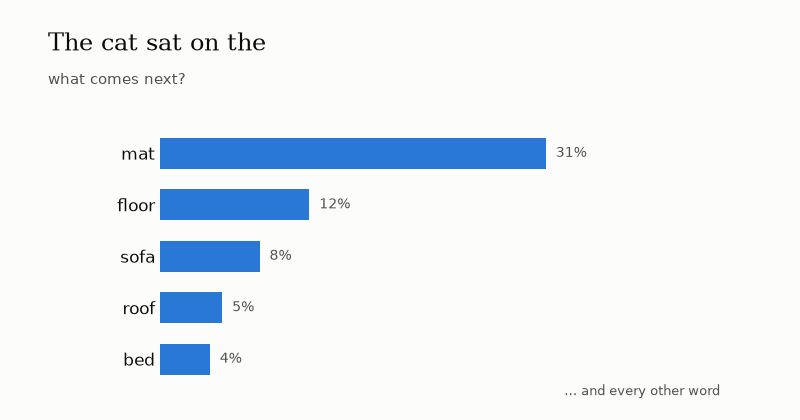
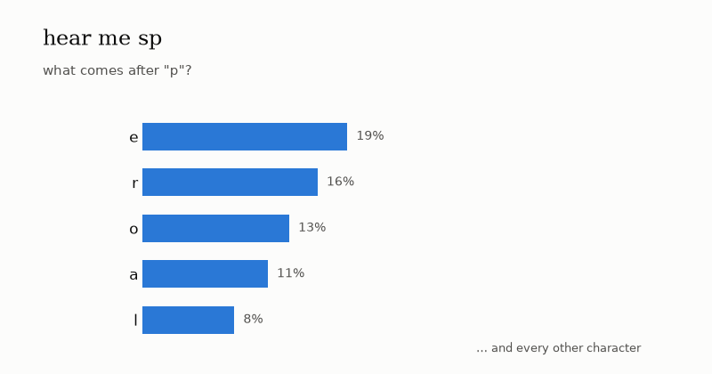
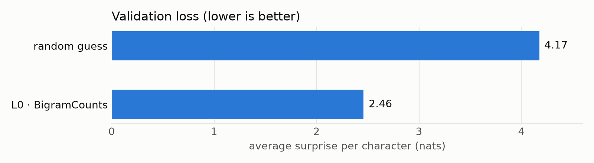

# Just Count: The Smallest Model That Writes

*Hello everyone! I recently started exploring how LLMs work, to get a better understanding of a technology that has crept into almost every part of our lives in the last few years. I'm starting this series to document what I learn and share it with the world.*

So this is Part 1 of a series where I try to build a **language model from scratch, one idea at a time**, as someone who is not comfortable with neural networks yet.

---

## The plan for this series

I'm following Andrej Karpathy's ["Let's build GPT"](https://www.youtube.com/watch?v=kCc8FmEb1nY), but I want to do it in a way I'll actually understand. So I'm splitting it into multiple levels:

1. **This post:** build the smallest *complete* system: text in, a model learns, text out, plus a way to **score** the outcome.
2. **The posts after this:** my journey towards a better model, one idea at a time, until it can generate **Indian text**. Andrej uses Shakespeare as his example, and I'll start there too so my numbers can be checked against his. But I thought it would be great to make it learn and write from Indic texts. (Let me know in the comments which datasets I should try the model on :P)

By the end there's a scoreboard that tells the whole story, from random gibberish to something that actually reads like text.

This first model is deliberately dumb. My hope is that every better model later simply plugs into the same setup.

---


## What is an LLM?

LLM, as the name suggests, is a

- **L**arge
- **L**anguage
- **M**odel

It's a sophisticated piece of tech that **predicts the next word** (more precisely, the next *token*: a word or a piece of one) in a language it was trained on. Each of the three words is doing real work:

**Large:** everything about these models is huge.

- **Data:** they're trained on trillions of words: a big chunk of the public internet, books and code. That's tens of terabytes of text even after cleaning, filtered down from raw web crawls that run into petabytes.
- **Compute:** training one takes thousands of GPUs running for weeks or months.
- **Parameters:** these are the adjustable numbers inside the model, tuned during training. GPT-3 (2020) had **175 billion** of them, and today's models have hundreds of billions or more.

**Language:** why language? Because almost all of that data is human language: articles, books, conversations, code. Language is what the model learns, and language is what it produces.

**Model:** the machine itself: a giant formula full of those parameters (also called *weights*). It takes the text a user gives it, computes a probability for every possible next token, and uses those to complete the text.

That's really the whole trick. Predict the next token, add it to the text, and ask again. Do that in a loop and the model *writes*:



*Made-up probabilities, but the real loop: guess the next word, pick one, append it, repeat.*

If you want a beautiful visual introduction to this, I highly recommend 3Blue1Brown's [Large Language Models explained briefly](https://www.youtube.com/watch?v=LPZh9BOjkQs).

Now for the fun part. Strip away the **Large**, and what's left, a **language model**, is something we can build on a laptop. The one in this post has **4,225** parameters. GPT-3 has 175 billion. Same idea, just a little smaller. :)

---


## How to build a machine that writes *something*?

Hmm, the simplest way: ask the machine to pick random characters, one after another, and boom, you have a machine that writes :P :P

```python
# an extremely dumb machine that writes, hehe..
chars = sorted(set(text))  # the 65 different characters in english
for i in range(200):
    print(random.choice(chars), end="")
```

I actually ran it. It writes:

```
B$WSPEA;p&$;OQz$MoPsW
HpeWGOeA;j?gfU'tCj:YhL.'QY:Q?jWthHigNV3ISHujVPc-Q&bmV.ObOyltFUESUpmhPEy;,BGHp.kjuT BVeBYqHt
UzJzAZzMGiH
cx!BhaR-R::x.DDvIUpOMamirsCSP.e!QP
```

Technically, that's writing. But it's a very dumb idea, because no human can read it. Every character is equally likely, so `$` and `z` show up just as often as `e` and space.

What could be a better idea?

**The insight:** instead of picking each character at random, pick it based on **how likely it is to come next**. In English, `e` is far more common than `z`, and after `q` comes `u` almost every time. Even a rough guess like that beats picking at random.

But how do we calculate those probabilities? How do we know what comes after `_`?

Answer : We learn them from examples. For that we first need a **dataset**: a long piece of real text where we can see which characters tend to follow which. I'm using [Tiny Shakespeare](https://raw.githubusercontent.com/karpathy/char-rnn/master/data/tinyshakespeare/input.txt), which contains about 1.1 million characters of plays:

```
First Citizen:
Before we proceed any further, hear me speak.
```

Once we have the probabilities, writing is the same loop as the LLM animation above, just one character at a time:



*Real probabilities this time, from the model we build in this post. It only looks at the last character, which is why "hear me sp" turns into "hear me spear" instead of "speak". The picks are dice rolls, so it doesn't always take the tallest bar.*

That's also what ChatGPT does, just with tokens instead of characters and a much better predictor.

---


## The pipeline

If you've followed along so far, the next steps are fairly obvious:

1. **Load** the text.
2. **Turn it into numbers**, because computers only understand numbers.
3. **Count** every pair of neighbouring characters and turn the counts into probabilities. This counting is our "training".
4. **Store** those probabilities somewhere. That's the model.
5. **Generate** new text by rolling dice with those probabilities. Yay!

There's one extra step: before training, we hide a slice of the text so we can score the model on text it hasn't seen (more on that below).

From an architecture point of view, it looks like this:

```
 ┌────────────┐   ┌────────────┐   ┌────────────┐   ┌────────────┐   ┌────────────┐   ┌────────────┐
 │ load data  │ → │ tokenizer  │ → │ training / │ → │   train    │ → │  evaluate  │ → │  generate  │
 │ .txt file  │   │ text ↔ ids │   │ validation │   │ the model  │   │   (score)  │   │    text    │
 │            │   │            │   │   split    │   │  (count)   │   │            │   │            │
 └────────────┘   └────────────┘   └────────────┘   └────────────┘   └────────────┘   └────────────┘
```

- **Load data:** read a `.txt` file. Swap the file and you change what the model learns.
- **Tokenizer:** computers don't read letters, they read numbers. The text uses 65 distinct characters, so each gets an id from 0 to 64. `"hi"` → `[46, 47]`.
- **Training / validation split:** the first 90% of the text is for learning. The last 10% is **locked away** for testing.
- **Train the model:** the **model** is a tensor, which is essentially a 2D array (a grid of numbers), that stores the probability of each next character. **Training** fills in those numbers from the character pairs. In this post, training just means counting.
- **Evaluate:** score the model, mostly on the locked-away 10%. More on this below.
- **Generate:** roll dice using the model's probabilities to write new text.

The pipeline script never changes. Leveling up means adding a new model and nothing else.

---


## The model: just count

Here's the simplest possible predictor: **look at the current character only, and guess the next one based on what usually followed it.** This is called a **bigram** model ("bi" = two: the current character and the next).

Take a tiny alphabet `{h, e, l, o}` and the training text `hello`. Every pair of neighbours is an example:

```
h→e   e→l   l→l   l→o
```

Tally them into a table. Each row is the current letter, and each column is what came next:

```
              next letter
             h   e   l   o
current  h [ 0   1   0   0 ]
         e [ 0   0   1   0 ]
         l [ 0   0   1   1 ]   ← after 'l': 'l' once, 'o' once
         o [ 0   0   0   0 ]
```

Divide each row by its total and you get **probabilities**. Row `l` becomes 50% `l`, 50% `o`.

To **generate**, look up the current letter's row and roll a die weighted by it:

```
start 'h' → always 'e' → always 'l' → 50% 'l' / 50% 'o' 🎲
```

That's the whole model. For Shakespeare it's a 65×65 table, and filling it in takes one pass over the text:

```python
# line the text up against itself shifted by one: "First" -> (F,i) (i,r) (r,s) (s,t)
current, following = data[:-1].tolist(), data[1:].tolist()
pair_counts = Counter(zip(current, following))
```

No training loop, no gradients. **Just count.**

Here's the actual trained table, zoomed in on space and lowercase letters:


*Each row is one die. Darker = more likely next character. (Rows don't add to 100% here because uppercase and punctuation are cropped out.)*

Even this dumb table has learned real English:

- After `q`, it's `u` 90% of the time.
- After `t`, the top guess is `h` (34%). Hello, "the".
- After `y` or `d`, about half the time comes a **space**: words end in y and d a lot.

One detail: of the 4,225 possible pairs, only **1,380** ever appear in the training text. If the model gave an unseen pair 0% probability and then met one in new text, it would be *infinitely* surprised (you'll see why in a second). So we pretend every pair was seen once extra. That's called [smoothing](https://en.wikipedia.org/wiki/Additive_smoothing).

---


## How do we know if it's any good?

This is the part I care most about, because every future post depends on it.

### Why not accuracy?

The obvious idea: check how often the model's top guess is right. That's a bad measure for language.

After `"th"`, both `e` ("the") and `a` ("that") are fine. A model that says *"e 60%, a 30%"* is doing a good job, but accuracy marks it **wrong** every time the real answer is `a`. Accuracy only counts the top guess and throws away everything else the model said.

### Loss: how surprised was the model?

Instead, ask: **how much probability did the model give to what actually happened?**

- It gave the real next char **100%** → not surprised at all → loss **0**
- It gave it **50%** → a bit surprised → loss **0.69**
- It gave it **1%** → very surprised → loss **4.6**
- It gave it **0%** → infinitely surprised → loss **∞** (that's why we smooth)

The formula is just `loss = -ln(probability of the real answer)`, averaged over many characters. It's called [cross-entropy](https://en.wikipedia.org/wiki/Cross-entropy). It rewards a model for being *sensibly unsure* rather than confidently wrong.

### Two anchors

A loss number means nothing alone, so I need reference points:

- **Perfect:** loss 0. Never achievable, because language is genuinely uncertain.
- **Random guessing:** every one of the 65 characters equally likely → `-ln(1/65)` = **4.17**. **This is the bar every model must clear.** Anything near 4.17 has learned nothing.


### Training vs validation: the honesty check

Remember the 10% we locked away? We measure loss on **both** parts:

- **Training loss:** on text the model learned from.
- **Validation loss:** on held-out text it has **never seen**.

Training data changes the model; validation data only judges it. If training loss is great but validation loss is bad, the model memorized instead of learning patterns. That's called [overfitting](https://en.wikipedia.org/wiki/Overfitting). Validation loss is the number that goes on the scoreboard.

---


## Results

Before counting, the table is all zeros (plus smoothing), so every character is equally likely. This is what that writes:

```
CpzlYaS ;czde.'wEiT,YVrzlGu-?YeNY
ijbo
Lzzj$KUKS-A.U FisVJiG HT,OP;W;,qe$zOAnsz-imHzPAkfEfYSgS;RTNBE:myOzk.
```

After one counting pass over the training text:

```
final: training_loss 2.4702  validation_loss 2.4599
```

```
Hanthniler pr e bla? br s rer?
onto y wha the ow, out r iloreatt s, te britemingoree ge.'setharme thex?
Cas we kide frd.
RIZAthigik!
thay taty we boors flce IO:
```

It's still gibberish, but it's **shaped** gibberish: word-sized chunks, spaces in sensible places, capitalized lines, `the`, `we`, `out`, even a speaker-ish `RIZA` and `IO:`. All from a table of pair counts.

Training and validation loss are nearly identical (2.47 vs 2.46), so there's no overfitting. That makes sense: a 65×65 table is too small to memorize a million characters.

---


## Scoreboard v1


| Level | Model        | How it learns | Validation loss | Sample                    |
| ----- | ------------ | ------------- | --------------- | ------------------------- |
| —     | random guess | —             | 4.17            | `CpzlYaS ;czde.'wEiT`     |
| 0     | BigramCounts | counting      | **2.46**        | `thay taty we boors flce` |




From 4.17 to 2.46 just by counting pairs.

---


## The ceiling

This model has a hard limit: it **only ever sees one character**. After `e`, it can't tell whether it's in `"the "` or `"thee"` or `"here"`. Every `e` gets the same die, forever.

Counting more text won't fix that. To look further back we'd need a bigger table: two characters back is 65³ ≈ 275k cells, and eight back is 65⁹ ≈ 21 quadrillion cells. Most would never be seen even once. **Counting doesn't scale.**

So the next step is to stop counting and start **learning** the table instead, by trial and error, with a method that doesn't care how big the model gets. That method (gradient descent) is what eventually trains a GPT.

**Next post:** *Same score, new engine.* We throw away counting, start from a table of zeros, and teach it by nudging.

---

*Code for this post:* `[mini_gpt/](../mini_gpt/)` *· run it with* `uv run python mini_gpt/train.py --model BigramCounts`