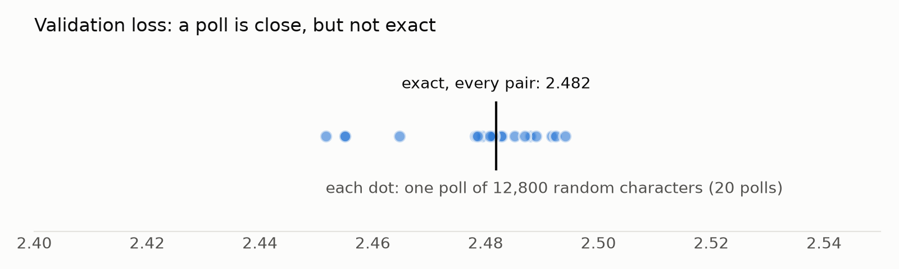

# Just Count: The Smallest Model That Writes

*Hello everyone! I recently started exploring how LLMs work, to get a better understanding of a technology that has crept into almost every part of our lives in the last few years. I'm starting this series to document what I learn and share it with the world.*

---

## The plan for this series

So this is Part 1 of a series where I try to build a **language model from scratch, one idea at a time**, as someone who is not comfortable with neural networks yet. I'm following Andrej Karpathy's ["Let's build GPT"](https://www.youtube.com/watch?v=kCc8FmEb1nY), but I want to do it in a way I'll actually understand. So I'm splitting it into multiple levels:

1. **This post:** build the smallest *complete* system: text in, a model learns, text out, plus a way to **score** the outcome.
2. **The posts after this:** my journey towards a better model, one idea at a time, until it can generate **Indian text**. Andrej uses Shakespeare as his example, and I'll start there too so my numbers can be checked against his. But I think it would be great to make it learn and write from Indic texts. (Let me know in the comments which datasets I should try the model on :P)

By the end we will also build a scoreboard that tells the whole story, from random gibberish to something that actually reads like text.

This first model is deliberately dumb. My hope is that every better model later simply plugs into the same setup.

---

## What is an LLM?

LLM, as the name suggests, is a

- **L**arge
- **L**anguage
- **M**odel

It's a sophisticated piece of tech that **predicts the next word** (more precisely, the next *token*: a word or a piece of one) in a language it was trained on. Each of the three words is doing real work:

**Large:** everything about these models is huge.

- **Data:** they're trained on trillions of words: a big chunk of the public internet, books and code. That's tens of terabytes of text even after cleaning, filtered down from raw web crawls that run into petabytes.
- **Compute:** training one takes thousands of GPUs running for weeks or months.
- **Parameters:** these are the adjustable numbers inside the model, tuned during training. GPT-3 (2020) had **175 billion** of them, and today's models have hundreds of billions or more.

**Language:** why language? Because almost all of that data is human language: articles, books, conversations, code. Language is what the model learns, and language is what it produces.

**Model:** the machine itself: a giant formula full of those parameters (also called *weights*). It takes the text a user gives it, computes a probability for every possible next token, and uses those to complete the text.

That's really the whole trick. Predict the next token, add it to the text, and ask again. Do that in a loop and the model *writes*:


*Made-up probabilities, but the real loop: guess the next word, pick one, append it, repeat.*

If you want a beautiful visual introduction to this, I highly recommend 3Blue1Brown's [Large Language Models explained briefly](https://www.youtube.com/watch?v=LPZh9BOjkQs).

Now for the fun part. Strip away the **Large**, and what's left, a **language model**, is something we can build on a laptop. The one in this post has **4,225** parameters. GPT-3 has 175 billion. Same idea, just a little smaller. :)

---

## How to build a machine that writes *something*?

Hmm, the simplest way: ask the machine to pick random characters, one after another, and boom, you have a machine that writes :P :P

```python
# an extremely dumb machine that writes, hehe..
chars = sorted(set(text))  # the 65 different characters in english
for i in range(200):
    print(random.choice(chars), end="")
```

I actually ran it. It writes:

```
B$WSPEA;p&$;OQz$MoPsW
HpeWGOeA;j?gfU'tCj:YhL.'QY:Q?jWthHigNV3ISHujVPc-Q&bmV.ObOyltFUESUpmhPEy;,BGHp.kjuT BVeBYqHt
UzJzAZzMGiH
cx!BhaR-R::x.DDvIUpOMamirsCSP.e!QP
```

Technically, that's writing. But it's a very dumb idea, because no human can read it. Every character is equally likely, so `$` and `z` show up just as often as `e` and space.

What could be a better idea?

**The insight:** instead of picking each character at random, pick it based on **how likely it is to come next**. In English, `e` is far more common than `z`, and after `q` comes `u` almost every time. Even a rough guess like that beats picking at random.

But how do we calculate those probabilities? How do we know what comes after `_`?

Answer : We learn them from examples. For that we first need a **dataset**: a long piece of real text where we can see which characters tend to follow which. I'm using [Tiny Shakespeare](https://raw.githubusercontent.com/karpathy/char-rnn/master/data/tinyshakespeare/input.txt), which contains about 1.1 million characters of plays:

```
First Citizen:
Before we proceed any further, hear me speak.
```

Once we have the probabilities, writing is the same loop as the LLM animation above, just one character at a time:


*Real probabilities this time, from the model we build in this post. It only looks at the last character, which is why "hear me sp" turns into "hear me spear" instead of "speak". The picks are dice rolls, so it doesn't always take the tallest bar.*

That's also what ChatGPT does, just with tokens instead of characters and a much better predictor.

---

## The pipeline

If you've followed along so far, the next steps are fairly obvious:

1. **Load** the text.
2. **Turn it into numbers**, because computers only understand numbers.
3. **Count** every pair of neighbouring characters and turn the counts into probabilities. This counting is our "training".
4. **Store** those probabilities somewhere. That's the model.
5. **Generate** new text by rolling dice with those probabilities. Yay!

There's one extra step: before training, we hide a slice of the text so we can score the model on text it hasn't seen (more on that below).

From an architecture point of view, it looks like this:

```
 ┌────────────┐   ┌────────────┐   ┌────────────┐   ┌────────────┐   ┌────────────┐   ┌────────────┐
 │ load data  │ → │ tokenizer  │ → │ training / │ → │   train    │ → │  evaluate  │ → │  generate  │
 │ .txt file  │   │ text ↔ ids │   │ validation │   │ the model  │   │   (score)  │   │    text    │
 │            │   │            │   │   split    │   │  (count)   │   │            │   │            │
 └────────────┘   └────────────┘   └────────────┘   └────────────┘   └────────────┘   └────────────┘
```

- **Load data:** read a `.txt` file. Swap the file and you change what the model learns.
- **Tokenizer:** computers don't read letters, they read numbers. The text uses 65 distinct characters, so each gets an id from 0 to 64. `"hi"` → `[46, 47]`.
- **Training / validation split:** the first 90% of the text is for learning. The last 10% is **locked away** for testing.
- **Train the model:** the **model** is a tensor, which is essentially a 2D array (a grid of numbers), that stores the probability of each next character. **Training** fills in those numbers from the character pairs. In this post, training just means counting.
- **Evaluate:** score the model, mostly on the locked-away 10%. More on this below.
- **Generate:** roll dice using the model's probabilities to write new text.

---

## The Learning Model: just count

Here's the simplest possible predictor: **look at the current character only, and guess the next one based on what usually followed it.** This is called a **bigram** model ("bi" = two: the current character and the next).

that is. : P(wi | wi-1) = C(wi-q, wi) / C(wi-1)

Take a tiny alphabet `{h, e, l, o}` and the training text `hello`. Every pair of neighbours is an example:

```
h→e   e→l   l→l   l→o
```

Tally them into a table. Each row is the current letter, and each column is what came next:

```
              next letter
             h   e   l   o
current  h [ 0   1   0   0 ]
         e [ 0   0   1   0 ]
         l [ 0   0   1   1 ]   ← after 'l': 'l' once, 'o' once
         o [ 0   0   0   0 ]
```

Divide each row by its total and you get **probabilities**. Row `l` becomes 50% `l`, 50% `o`.

To **generate**, look up the current letter's row and roll a die weighted by it:

```
start 'h' → always 'e' → always 'l' → 50% 'l' / 50% 'o' 🎲
```

That's the whole model. For Shakespeare it's a 65×65 table, and filling it in takes one pass over the text:

```python
# line the text up against itself shifted by one: "First" -> (F,i) (i,r) (r,s) (s,t)
current, following = data[:-1].tolist(), data[1:].tolist()
pair_counts = Counter(zip(current, following))
```

No training loop, no gradients. **Just count.**

Here's the actual trained table, zoomed in on space and lowercase letters:


*Each row is one die. Darker = more likely next character. (Rows don't add to 100% here because uppercase and punctuation are cropped out.)*

Some sailent observations:

- After `q`, it's `u` 90% of the time.
- After `t`, the top guess is `h` (34%). Hello, "the".
- After `y` or `d`, about half the time comes a **space**: words end in y and d a lot.

One detail: of the 4,225 possible pairs, only **1,380** ever appear in the training text. One problem with this approach is the problem of zero probability for unseen word pairs, If the model gave an unseen pair 0% probability, then it would never be part of the generated text, to fix that, we apply a process of **[smoothing](https://en.wikipedia.org/wiki/Additive_smoothing)**, so that even the unseen pairs get assigned some non zero probabilites.

[add example of generation before smoothing and after smoothing as well, so that readers get a sense of whats going on]

---

## How do we know if it's any good?

Since we are playing with the probability of each character, the obvious idea is to check how often the model's top guess is right. But that's a bad measure for language.

After `"th"`, both `e` ("the") and `a` ("that") are fine. A model that says *"e 60%, a 30%"* is doing a good job, but accuracy marks it **wrong** every time the real answer is `a`. Accuracy only counts the top guess and throws away everything else the model said.

So we need a score that looks at the *whole* guess, not just the top pick. Let's build it one step at a time.

### Step 1: score a single guess

Take one real pair from the text, say `t` followed by `h`. Ask the model: **how much probability did you give to what actually came next?**

```python
p = probs[current][following]   # the chance the model gave to the real next character
```

Our counted table says that after `t`, the chance of `h` is **34%**. That's a decent guess. If it had said 90%, even better. If it had said 1%, it was badly caught off guard.

So a good model gives **high** probability to what really happens. Now we just need to turn "high probability = good" into a number where **lower is better**, like a penalty.

### Step 2: turn probability into surprise

Here's the penalty everyone uses:

```python
surprise = -math.log(p)   # natural log
```

| The model gave the real next character… | How surprised? | Surprise |
| --------------------------------------- | -------------- | -------- |
| 100%                                    | not at all     | **0**    |
| 50%                                     | a bit          | **0.69** |
| 1%                                      | very           | **4.6**  |
| 0%                                      | infinitely     | **∞**    |

Why `-log` and not something else? This comes from information theory, and I'm going to take it on trust for now. (If you want the real story, StatQuest's [Entropy (for data science) Clearly Explained!!!](https://www.youtube.com/watch?v=YtebGVx-Fxw) builds surprise from scratch, and 3Blue1Brown's [Solving Wordle using information theory](https://www.youtube.com/watch?v=v68zYyaEmEA) shows the same idea through a game.) But you can feel why it's a sensible choice:

- **Sure and right costs nothing.** 100% → 0.
- **The less you expected it, the more it hurts.** And it hurts *a lot* near 0%. Saying "this will never happen" and then being wrong is the worst possible mistake. That's why we smoothed the counts: no pair is ever given exactly 0%.

### Step 3: average it over lots of text

One guess tells us little. So walk through real text and score **every** character, then take the average. Here's our model reading `" the king"`:

| Current → next | Chance the model gave | Surprise |
| -------------- | --------------------- | -------- |
| `␣` → `t`      | 14.1%                 | 1.96     |
| `t` → `h`      | 34.1%                 | 1.08     |
| `h` → `e`      | 35.3%                 | 1.04     |
| `e` → `␣`      | 29.2%                 | 1.23     |
| `␣` → `k`      | **0.9%**              | **4.66** |
| `k` → `i`      | 14.4%                 | 1.94     |
| `i` → `n`      | 23.2%                 | 1.46     |
| `n` → `g`      | 10.7%                 | 2.24     |
|                | **average**           | **1.95** |

"the" is easy for it. Then a word starting with `k` comes along, which it didn't see coming at all, and the surprise spikes.

In code, that's the whole idea:

```python
def average_surprise(probs, data):
    surprises = []
    for current, following in zip(data[:-1], data[1:]):   # every neighbouring pair
        p = probs[current][following]
        surprises.append(-math.log(p))
    return sum(surprises) / len(surprises)
```

**That average is the loss.** Its official name is **cross-entropy** (Aurélien Géron's [11-minute intro](https://www.youtube.com/watch?v=ErfnhcEV1O8) is the clearest explanation I found). Lower loss = less surprised by real text = a better model.

#### The same thing in our real code

The loop above is for understanding. In `mini_gpt`, the scoring happens in one line of `models/base.py`:

```python
logits = self.logits(idx)                    # for each current character: a row of 65 scores
loss = F.cross_entropy(logits, targets)      # average surprise at the real next characters
```

`F.cross_entropy` is PyTorch's built-in version of our `average_surprise`. Spelled out, it does exactly the three steps from above:

```python
probs = F.softmax(logits, dim=-1)            # scores -> probabilities (each row adds up to 100%)
p = probs[range(len(targets)), targets]      # Step 1: the chance each real next character got
loss = (-p.log()).mean()                     # Steps 2 and 3: surprise, then average
```

### Step 4: two anchors

A loss number means nothing alone. Is 1.95 good? We need reference points:

- **Perfect:** loss 0. Never achievable, because language is genuinely uncertain. Even Shakespeare couldn't tell you for sure what comes after "th".
- **Random guessing:** every one of the 65 characters equally likely, so every guess gets 1/65:
  ```python
  -math.log(1 / 65)   # = 4.17
  ```

  **This is the bar every model must clear.** Anything near 4.17 has learned nothing.

  
[this is food for thought section idea -> we need a short sections like this to encourage users to think more deeply or in a alternative fasion or to challenge their understanding with wisdom nuggets, we can expand this a bit more with some visualization if needed, here the insight is, the lower the characters or tokens the model is torn between, the better the outcome.]  
Note: Here's a handy way to feel a loss number: `e^loss` tells you roughly how many characters the model is "torn between". Random guessing is e^4.17 = **65**, torn between everything. A loss of 2.46 is e^2.46 ≈ **12**. Same alphabet, but now it's like choosing among 12 instead of 65.


### Step 5: training vs validation, the honesty check

There's one trap left. If we score the model on the **same** text it learned from, it can look great just by having memorized that text. A student who has seen the exam answers will ace the exam, but that doesn't mean they learned anything.

That's why, before any counting, we locked away the last 10% of the text:

```python
n = int(0.9 * len(data))
train_data = data[:n]   # the model learns from this
val_data   = data[n:]   # the model never sees this until the test
```

Only `train_data` ever changes the model. Then we score it on **both** parts, using exactly the same measuring stick:

```python
model.count_pairs(train_data)   # learn: only from the training text

training_loss   = average_surprise(probs, train_data)   # how well it fits what it studied
validation_loss = average_surprise(probs, val_data)     # how well it does on new text
```

How to read the two numbers:

- **Both close together:** the model learned patterns that carry over to new text. 👍
- **Training loss much lower than validation loss:** the model memorized its training text instead of learning general patterns. That's called **overfitting** (StatQuest: [Bias and Variance](https://www.youtube.com/watch?v=EuBBz3bI-aA)).

Validation loss is the honest number, so **validation loss is the number that goes on the scoreboard.**

### Step 6: batching, a poll instead of a census

Strictly speaking, the loss is the average surprise over **every** character: about 1 million in the training text and 111,540 in the validation text. That's the exact answer. But that's not quite what our code does. It takes a **poll**.

It works like an opinion poll before an election: instead of asking the whole country, you ask a few thousand random people and get very close to the real answer.

The `get_batch` brick does the sampling. It cuts out random chunks of text, plus the same chunks shifted one character to the right:

```
text "hello!", chunk size 4  ->  x = "hell"   (current characters)
                                 y = "ello"   (what really came next)
```

Lined up, every position is one guess to score: `h→e`, `e→l`, `l→l`, `l→o`. So a chunk of 8 characters gives 8 guesses.

```python
x, y = get_batch(val_data, batch_size=32, block_size=8)   # 32 random chunks of 8 characters
```

One **batch** is 32 chunks × 8 characters = **256 guesses**. The scorecard averages 50 batches, which is **12,800 guesses** in total. Here's the real code from `evaluate.py`:

```python
def estimate_loss(model, data, cfg):
    losses = []
    for _ in range(cfg.eval_iters):                              # 50 batches
        x, y = get_batch(data, cfg.batch_size, cfg.block_size)   # 32 random chunks of 8
        _, loss = model.forward(x, y)                            # average surprise on this batch
        losses.append(loss.item())
    return sum(losses) / len(losses)
```

Why not just score everything? For our tiny 65×65 table, scoring every character would be instant. But real LLMs train on *hundreds of billions* of tokens, and scoring all of them every time you want a progress report would cost about as much as the training itself. This is a standard practice for evaluation and benchmarking of any model. 

The price of a poll is a little **noise**. I ran the same poll 20 times on the validation text:



Every poll lands between 2.45 and 2.49, around the exact value of 2.482. Good enough to compare models, but it means **a difference in the second decimal place is just noise.** If a future model improves by 0.01, that's not a win.

---

## Results

### Before: an empty table

Before counting, the table is all zeros (plus smoothing), so every character is equally likely. 

[add training loss , validation loss for the random one as well]

```
CpzlYaS ;czde.'wEiT,YVrzlGu-?YeNY
ijbo
Lzzj$KUKS-A.U FisVJiG HT,OP;W;,qe$zOAnsz-imHzPAkfEfYSgS;RTNBE:myOzk.
```

### After: one counting pass

```
final: training_loss 2.4702  validation_loss 2.4599
```

```
Hanthniler pr e bla? br s rer?
onto y wha the ow, out r iloreatt s, te britemingoree ge.'setharme thex?
Cas we kide frd.
RIZAthigik!
thay taty we boors flce IO:
```

It's still gibberish, but it's **shaped** gibberish: word-sized chunks, spaces in sensible places, capitalized lines, `the`, `we`, `out`, even a speaker-ish `RIZA` and `IO:`. All from a table of pair counts.

### Reading the numbers

Now we can read these numbers with everything from the previous section:

|                 | training_loss | validation_loss | Torn between about… |
| --------------- | ------------- | --------------- | ------------------- |
| before counting | 4.17          | 4.17            | 65 characters       |
| after counting  | 2.47          | 2.46            | 12 characters       |

- **4.17 → 2.46:** the model went from torn between all 65 characters to torn between about 12. That's a lot of uncertainty removed just by counting.
- **Training ≈ validation:** no overfitting. 
- **Validation slightly *lower* than training?** That's the poll noise from Step 6.

---

## Scoreboard v1

| Level | Model        | How it learns | Validation loss | Sample                    |
| ----- | ------------ | ------------- | --------------- | ------------------------- |
| —     | random guess | —             | 4.17            | `CpzlYaS ;czde.'wEiT`     |
| 0     | BigramCounts | counting      | **2.46**        | `thay taty we boors flce` |


From 4.17 to 2.46 just by counting pairs!

---

## The ceiling

This model has a hard limit: it **only ever sees one character**. After `e`, it can't tell whether it's in `"the "` or `"thee"` or `"here"`. Every `e` gets the same die, forever.

Counting more text won't fix that. To look further back we'd need a bigger table: two characters back is 65³ ≈ 275k cells, and eight back is 65⁹ ≈ 21 quadrillion cells. Most would never be seen even once. **Counting doesn't scale.**

So the next step is to stop counting and start **learning** the table instead, by trial and error, with a method that doesn't care how big the model gets. That method (gradient descent) is what eventually trains a GPT.

---

## Wrapping up

In this post we built:

- **A pipeline:** load data → tokenizer → training / validation split → train → evaluate → generate.
- **The simplest language model:** a 65×65 table of "what usually comes next", trained by just counting.
- **A scorecard:** the average surprise (cross-entropy), measured on text the model has never seen, with two anchors (4.17 = random, 0 = perfect) and a poll to keep it fast.
- **Scoreboard v1:** from 4.17 to 2.46.

The model is dumb, but the setup isn't. Every future model plugs into the same pipeline and gets judged by the same scorecard, so every improvement shows up as a new row on the scoreboard.

**Next post:** *Same score, new engine.* We throw away counting, start from a table of zeros, and teach it by nudging, and we'll watch the loss fall step by step.

If something here didn't click, or you know a better way to explain it, tell me in the comments. I'm learning this too :)

---

*Code for this post:* [mini_gpt/](../mini_gpt/) · *run it with* `uv run python mini_gpt/train.py --model BigramCounts`